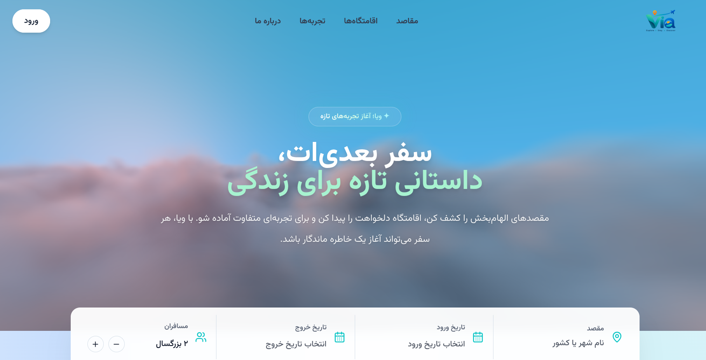
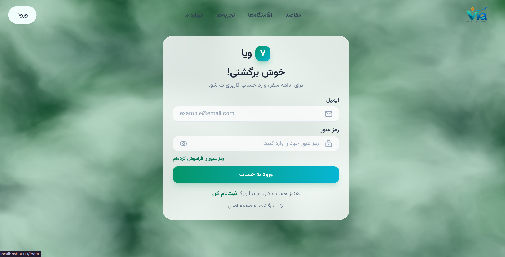
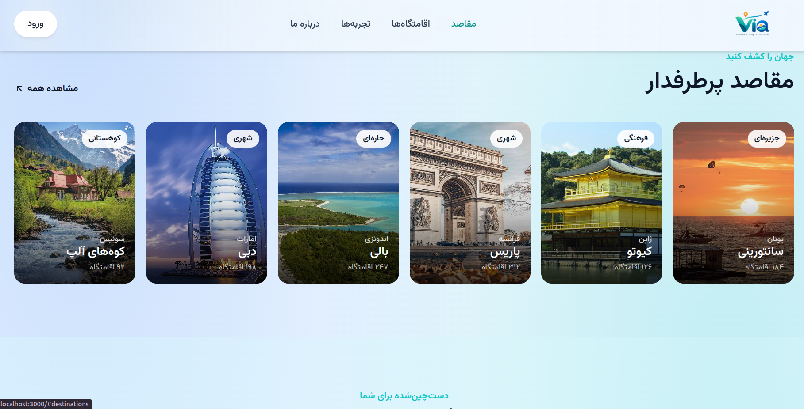

# ✈️ Via — Discover Your Next Journey
## 📸 Screenshots | تصاویر پروژه

### Home Page


### Login Page


### Sign Up Page

**Via** is a modern, responsive travel website designed to help users discover inspiring destinations and explore unique travel experiences.

ویا یک وب‌سایت گردشگری مدرن است که با هدف معرفی مقصدهای جذاب و تجربه‌های متفاوت سفر طراحی شده است.

## ✨ Features | امکانات

- 🎨 Modern and clean UI
- 📱 Responsive design for desktop, tablet, and mobile
- 🔐 Login and registration pages
- 🌍 Destination discovery
- 🏨 Accommodation section
- 💫 Animated background and interactive visual elements
- 🇮🇷 Persian language support and RTL layout

## 🛠️ Tech Stack | تکنولوژی‌ها

- Next.js
- React
- TypeScript
- Tailwind CSS
- HTML & CSS

## 📸 Screenshots | تصاویر پروژه

### Home Page
<!-- Add your homepage screenshot here -->
<!--  -->

### Login Page
<!--  -->

### Sign Up Page
<!--  -->

## 🚀 Getting Started | اجرای پروژه

### 1. Clone the repository

```bash
git clone YOUR_GITHUB_REPOSITORY_URL
```

### 2. Navigate to the project directory

```bash
cd projectVia
```

### 3. Install dependencies

```bash
npm install
```

### 4. Start the development server

```bash
npm run dev
```

Open `http://localhost:3000` in your browser.

## 👩‍💻 Developer

Developed by **Ehsan Safaeii**.

---

*Via — Every journey begins with a discovery.*